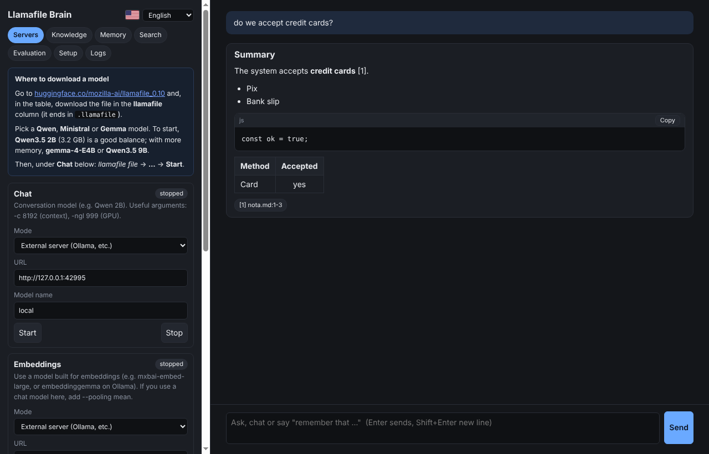
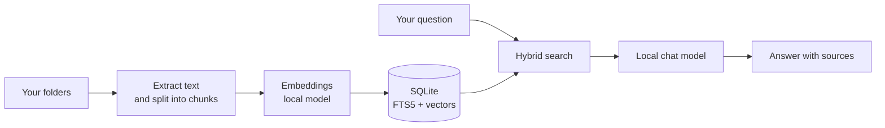

<div align="center">


**Chat with your own files using a local AI — private, offline, no cloud.**

[](https://github.com/natancabral/llamafile-brain/releases)
[](LICENSE)


[Download](#-download) · [Quick start](#-quick-start-5-minutes) · [Documentation](#-documentation) · [Contributing](CONTRIBUTING.md)

**English** · [Português](README.pt.md)

</div>

---

## What it is

**Llamafile Brain** is a desktop app that turns your document folders into a **knowledge base you can talk to**. You point it at your folders, the app indexes the content, and a language model **running on your own machine** answers your questions, citing which file each piece of information came from.

Use it to study, research, document projects, organize contracts and notes — any time you want to **ask your own material** without sending it to an external service.

> **About "training on your documents":** the app uses **RAG** (retrieve, then answer). It does not change the model: for every question it hands the model only the relevant excerpts. The result: no training cost, instant updates (just save the file) and cited sources. See [how to improve results](docs/USAGE.md#6-training-on-your-documents).

## Features

- 🌐 **English, Portuguese and Spanish** interface — switch language from the selector at the top of the sidebar (English by default).
- 💬 **Markdown chat** (headings, lists, tables, code with a copy button) with cited sources.
- 🔒 **100% local**: [llamafile](https://github.com/mozilla-ai/llamafile) models (Mozilla) or Ollama, no telemetry.
- 🔎 **Hybrid search in SQLite**: keywords (FTS5/BM25) + vectors, fused with RRF — a single `brain.sqlite` file.
- 📁 **You choose the locations**: document folders, a *brain* folder (your notes, with priority) and where the database lives.
- 🔄 **Automatic reindexing** when files change; incremental indexing.
- 🗃️ **SQLite databases and huge files**: `.sqlite .sqlite3 .db .db3` files are read table by table (schema + rows). Small databases (up to ~2,000 chunks) are also embedded for semantic search; bigger ones and large `.sql` dumps (up to 4 GB) are read as a stream and searched by keyword with constant memory.
- 📄 **Many formats**: text and code, PDF, Word, Excel, PowerPoint, ODT/ODS/ODP, SQL, JSON, CSV; legacy formats (`.doc` `.xls` `.ppt` `.rtf`) through LibreOffice.
- 🖼️ **OCR** for scanned PDFs and images (Tesseract).
- 🧠 **Explicit memory**: `remember that…`, `forget…`, `what do you remember` + a fixed profile — you control what is stored (the commands also work in Portuguese and Spanish).
- 🎯 **Evaluation tab**: measure search quality with your own questions (hit rate and MRR).
- ⏸️ **Pause / resume indexing** whenever you need your RAM back; **indexing log** (what was captured from each file) and **problems log** (skipped files with path, size and reason — a bad file never stops the run).
- 🛟 **Answers that do not invent**: hidden honesty rules, low temperature, a *strict mode* that says "I did not find this in your files" instead of guessing, and a **source-confidence %** under each answer based on the search evidence.
- 🖥️ **Knows your machine**: a *Computer* tab (name, model, CPU, RAM, GPU, disks, network) and the chat can answer "what is my GPU?" from real data — no Python needed.
- ⚡ **Performance under control**: GPU automatic / on / CPU only, context size (with RAM advice), history and question-token limits.
- 🧰 **Installs what is missing** (OCR, Poppler, LibreOffice) with one click, asking for confirmation first.
- 🛡️ **Secure by default**: only reads the folders you allow, never indexes secrets (`.env`, keys), isolated UI.

## Screenshots



## How it works



Details in [docs/ARCHITECTURE.md](docs/ARCHITECTURE.md).

## 📥 Download

Get the installer for your platform from the [**Releases**](https://github.com/natancabral/llamafile-brain/releases) page.

| System | File | How to install |
|---|---|---|
| **Ubuntu / Debian** | `llamafile-brain-X.Y.Z-linux-amd64.deb` | `sudo apt install ./llamafile-brain-*-linux-amd64.deb` |
| **Fedora** | `llamafile-brain-X.Y.Z-linux-x86_64.rpm` | `sudo dnf install ./llamafile-brain-*.rpm` |
| **openSUSE** | `llamafile-brain-X.Y.Z-linux-x86_64.rpm` | `sudo zypper --no-gpg-checks install ./llamafile-brain-*.rpm` |
| Any Linux | `….AppImage` | `chmod +x *.AppImage && ./llamafile-brain-*.AppImage` |
| Any Linux | `….tar.gz` | extract and run `llamafile-brain` |
| **Windows 64-bit** | `…-win-x64-setup.exe` (installer) or `…-win-x64-portable.exe` | double-click |
| **Windows 32-bit** | `…-win-ia32-setup.exe` or `…-win-ia32-portable.exe` | double-click |
| **macOS Intel** | `…-mac-x64.dmg` | drag to *Applications* |
| **macOS Apple Silicon (M1+)** | `…-mac-arm64.dmg` | drag to *Applications* |

Verify integrity with the release's `SHA256SUMS.txt` (`sha256sum -c SHA256SUMS.txt`).

> **About code signing:** the installers are not signed yet. On **Windows**, SmartScreen may warn → *More info → Run anyway*. On **macOS**, right-click → *Open* (or `xattr -cr "/Applications/Llamafile Brain.app"`). On **Linux (AppImage)** with Ubuntu 24.04+, you may need `--no-sandbox`. More in [Troubleshooting](docs/TROUBLESHOOTING.md).

Want to run from source? See [Development](#-development).

## 🚀 Quick start (5 minutes)

1. **Download a chat model**: a `.llamafile` (e.g. *Qwen3.5 2B*) from [huggingface.co/mozilla-ai/llamafile_0.10](https://huggingface.co/mozilla-ai/llamafile_0.10) — use the **llamafile** column.
2. **Have an embeddings model** (recommended): install [Ollama](https://ollama.com) and run `ollama pull embeddinggemma-2:270m` (details [below](#-what-to-install-and-what-each-piece-is-for)).
3. Open **Llamafile Brain** → **Servers** tab:
   - **Chat:** *Start llamafile* → pick the file → **Start**.
   - **Embeddings:** *External server* → `http://127.0.0.1:11434` → model `embeddinggemma-2:270m`.
4. **Knowledge** tab → **Add folder** with your documents → **Index now**.
5. Ask in the chat. Done! 🎉

Full guide: [docs/USAGE.md](docs/USAGE.md) · Choosing models: [docs/MODELS.md](docs/MODELS.md).

## 🧩 What to install, and what each piece is for

Llamafile Brain needs **two models** (a third is optional). Each one has a different job:

| Piece | What it does | When it runs |
|---|---|---|
| **Chat model** | Reads the excerpts found in your files and **writes the answer** | At every question |
| **Embeddings model** | Turns text into numbers (vectors) so the app can **find passages by meaning**, not only by exact words | While indexing, and once per question |
| **Reranker** *(optional)* | Re-orders the found passages by relevance. Slightly better answers, but more RAM/CPU — leave it off on modest machines | At every question, if enabled |

### 1. Chat model → download a llamafile

A [llamafile](https://github.com/mozilla-ai/llamafile) is a single file that contains the model and the server; no installation.

1. Open [huggingface.co/mozilla-ai/llamafile_0.10](https://huggingface.co/mozilla-ai/llamafile_0.10) and download a `.llamafile` from the **llamafile** column. A 2B model (e.g. *Qwen3.5 2B*) runs on almost any computer; bigger ones answer better but need more RAM.
2. Linux/macOS: `chmod +x model.llamafile`. Windows: nothing to do (the app launches it).
3. In the app: **Servers → Chat → Start llamafile →** pick the file **→ Start**.

### 2. Embeddings model → Ollama (recommended)

[Ollama](https://ollama.com) is a small program that serves models on `http://127.0.0.1:11434`.

1. Install Ollama (Linux: `curl -fsSL https://ollama.com/install.sh | sh`; Windows/macOS: installer from ollama.com).
2. Download an embeddings model:

   | Model | Command | Use it when |
   |---|---|---|
   | **embeddinggemma-2** *(best performance)* | `ollama pull embeddinggemma-2:270m` | default choice: small (~300 MB), fast, multilingual |
   | embeddinggemma | `ollama pull embeddinggemma` | if the line above is not available in your Ollama version |
   | nomic-embed-text | `ollama pull nomic-embed-text` | very low RAM, mostly English |
   | bge-m3 | `ollama pull bge-m3` | best quality for long or mixed-language documents; heavier |

3. Check that it answers: `curl http://127.0.0.1:11434/api/tags` lists the model.
4. In the app: **Servers → Embeddings → External server →** URL `http://127.0.0.1:11434`, model = the exact name you pulled (e.g. `embeddinggemma-2:270m`) **→ Start**. The status turns *running* only after a real test call succeeds; otherwise the error is shown.

> **Changing the embeddings model later?** Vectors from different models are not compatible: click **Clear** and **Index now** again.

### 3. Reranker (optional)

Leave it off at first. Enable it later in **Servers → Reranker** and **Search** only if you want extra precision and have spare RAM.

### Which setup should I use?

- **Light computer (8 GB RAM):** chat llamafile 2B + `embeddinggemma-2:270m`, reranker off.
- **Comfortable computer (16 GB+ / GPU):** a larger chat model + `embeddinggemma-2:270m` or `bge-m3`.

More detail in [docs/MODELS.md](docs/MODELS.md).

## Settings (left panel)

| Tab | What it does |
|---|---|
| **Setup** | OCR (enable, languages, max pages) and installing Tesseract, Poppler and LibreOffice |
| **Servers** | Chat, Embeddings and Reranker: start a llamafile (port, GPU, context size, arguments) or use an external server (Ollama etc.). Default ports: 8871, 8872, 8873 |
| **Knowledge** | SQLite folder, *brain* folder, document folders, ignore list, automatic reindexing, Index/Clear |
| **Memory** | On/off, add/delete, fixed profile, character limit |
| **Search** | Use files, question token limit, top-k, context, history, temperature, strict mode and minimum relevance, vector×keyword weight, reranker |
| **Evaluation** | Measures search quality with your own set of questions |
| **Computer** | Data about this machine: name, model, system, CPU, RAM, GPU, disks and network |
| **Logs** | Output of the servers, the **indexing log** (what was captured) and the **problems log** (skipped files) |

## Language

The interface, the messages and the app's replies to memory commands are available in **English** (default), **Português** and **Español**. Use the selector at the top of the sidebar; the choice is saved. The model itself answers in the language of your question.

## Memory

| You say | The app does |
|---|---|
| `remember that my team uses pnpm` | stores it |
| `what do you remember?` | lists it |
| `forget #3` / `forget pnpm` | deletes it |

Memory is written **only** by these commands (never by the model) and exported to `<brain folder>/memory.md`. The same commands work in Portuguese (`lembre que…`, `esqueça…`, `o que você lembra`) and Spanish (`recuerda que…`, `olvida…`, `qué recuerdas`).

## Supported formats

| Type | Extensions |
|---|---|
| Text and code | `.md .txt .rst .json .yml .toml .xml .csv .sql .js .ts .py .java .go .rs .php .c .cpp .sh .html .css` and more |
| SQLite databases | `.sqlite .sqlite3 .db .db3`: small ones get vectors + keyword search; big ones (up to 4 GB) are streamed, keyword-only |
| Huge `.sql` dumps (keyword search) | `.sql` above 1 MB (up to 4 GB, read as a stream) |
| Documents | `.pdf` (with OCR if scanned), `.docx`, `.odt` |
| Spreadsheets | `.xlsx`, `.xlsm`, `.ods` |
| Presentations | `.pptx`, `.odp` |
| Legacy formats (LibreOffice) | `.doc`, `.xls`, `.ppt`, `.rtf` |
| Images (OCR) | `.png .jpg .jpeg .tif .tiff .bmp .webp` |

## 🛠️ Development

Requirements: **Node 22.12+** (the app itself runs on Electron's own Node; this is for the scripts and tests). Works with **npm** or **yarn** (classic 1.x or 2+; for Yarn 2+ the included `.yarnrc.yml` already selects `node_modules`).

```bash
git clone https://github.com/natancabral/llamafile-brain.git
cd llamafile-brain
npm install             # or: yarn
npm start               # or: yarn start      -> opens the app
npm test                # or: yarn test       -> unit and integration tests
npm run e2e             # or: yarn e2e        -> end-to-end test with the real Electron
npm run setup           # or: yarn setup      -> installs OCR/LibreOffice (optional)
```

> The repository's official lockfile is `package-lock.json` (used by CI). If you use yarn, your local `yarn.lock` is git-ignored.

On Linux, if Electron complains about the *SUID sandbox*: `npm run start:linux` / `yarn start:linux` (fixes the permission, asks for sudo) or `npm run start:dev` / `yarn start:dev` (no sandbox, development only).

### Folder structure

```
llamafile-brain/
├── src/
│   ├── main.js            # main process: settings, IPC, servers, indexing
│   ├── preload.js         # secure bridge between the UI and the main process
│   ├── shared/i18n.js     # translations (en / pt / es), used by main and renderer
│   ├── core/              # pure logic (no Electron): RAG, SQLite, indexer, chunker, OCR…
│   └── renderer/          # UI (HTML/CSS/JS), safe Markdown
├── scripts/               # release, setup, icons, sandbox fix
├── test/                  # tests + e2e/ (real Electron)
├── assets/                # logo and icon
├── build/                 # packager icons
├── docs/                  # guides (usage, models, architecture, releases, troubleshooting); docs/pt = Portuguese
├── .github/               # CI, automatic release, issue/PR templates
└── package.json
```

### 🌍 Adding or fixing a translation

All UI text lives in [`src/shared/i18n.js`](src/shared/i18n.js) as `key: [English, Português, Español]`. Add a key there, use it in `index.html` with `data-i18n="key"` (or `t('key')` in code), and run `npm test` — the test suite checks that every key has all three languages and that every key used in the code exists.

### 📦 Building the installers (releases)

```bash
npm run release          # whatever your system can build
npm run release:linux    # .deb (Ubuntu/Debian), .rpm (Fedora/openSUSE), AppImage, .tar.gz
npm run release:win      # Windows 64 and 32-bit (installer and portable)
npm run release:mac      # macOS Intel and Apple Silicon (.dmg and .zip) — on a Mac only
npm run release:all      # tries all three
```

Files land in `dist/` with `SHA256SUMS.txt`. To build **everything at once** without owning all three systems, push a tag and let GitHub Actions do it:

```bash
git tag v0.2.0 && git push origin main --tags
```

Details (prerequisites, code signing): [docs/RELEASING.md](docs/RELEASING.md).

## 🔐 Privacy and security

- Everything runs locally; the app only talks to the servers **you** configure (`127.0.0.1` by default).
- It only reads the folders you add; symbolic links are not followed; secrets (`.env`, keys, `credentials*`) are never indexed.
- Isolated UI (`contextIsolation`, sandbox, CSP) and Markdown rendered without `innerHTML`.
- Questions or vulnerabilities: [SECURITY.md](SECURITY.md).

## Limitations

- Quality depends on the models: a small model (2B) answers more simply and can be wrong. Check the cited sources and use the **Evaluation** tab.
- Vector search is brute force (in memory up to 20,000 vectors, then scanned in blocks with constant RAM). Huge `.sql` and SQLite files are searched by keyword only — no semantic search in them.
- The source-confidence % measures how well your files support an answer; it does not guarantee the answer is true.
- The *reranker* endpoint format varies between servers.
- Installers are not code-signed (see the note under [Download](#-download)).
- Linux is 64-bit only (Electron no longer ships 32-bit builds).

## 📚 Documentation

| | |
|---|---|
| [Usage guide](docs/USAGE.md) | from zero to the first answer; how to improve results |
| [Models](docs/MODELS.md) | which models to use for chat, embeddings and reranker |
| [Architecture](docs/ARCHITECTURE.md) | modules, flow, database, security |
| [Releases](docs/RELEASING.md) | how to build and publish the installers |
| [Troubleshooting](docs/TROUBLESHOOTING.md) | common errors and how to fix them |
| [Changelog](CHANGELOG.md) | version history |

Documentação em português: [README.pt.md](README.pt.md) · [docs/pt/](docs/pt/).

## Roadmap

- [ ] Code signing (Windows and macOS) and automatic updates
- [ ] Indexed vector search (`sqlite-vec`) for very large bases
- [ ] More formats (EPUB, e-mail, offline HTML)
- [ ] More interface languages
- [ ] ARM packages for Linux and Windows

Suggestions are welcome in the [issues](https://github.com/natancabral/llamafile-brain/issues).

## 🤝 Contributing

Contributions are very welcome! Read [CONTRIBUTING.md](CONTRIBUTING.md) and the [Code of Conduct](CODE_OF_CONDUCT.md).

## License

The MIT License.

## Author

<table>
  <tr>
    <td>
      
    </td>
    <td>
      Natan Cabral<br />
      <a href="mailto:natancabral@hotmail.com">natancabral@hotmail.com</a><br />
      <a href="https://github.com/natancabral/">https://github.com/natancabral/</a>
    </td>
  </tr>
</table>

> **Notice:** this is an independent project, **not affiliated with Mozilla or Mozilla.ai**. *llamafile* is a Mozilla.ai project ([github.com/mozilla-ai/llamafile](https://github.com/mozilla-ai/llamafile)); the models have their own licenses.
