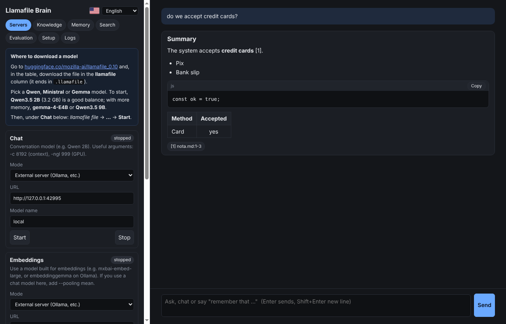
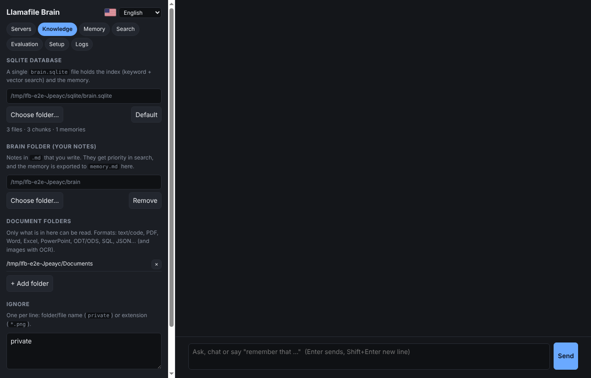
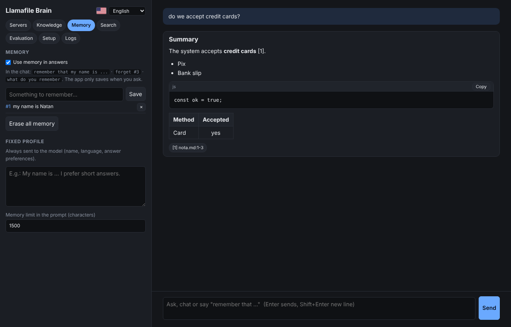
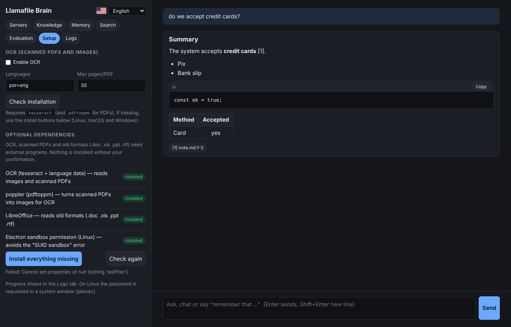
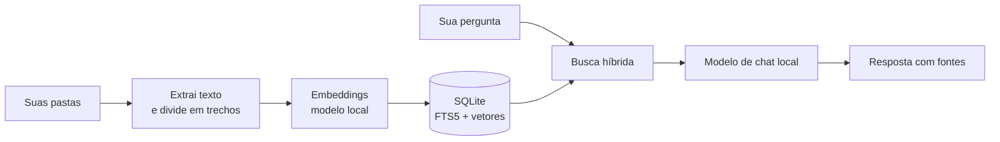

<div align="center">


**Converse com os seus próprios arquivos usando IA local — privado, offline e sem nuvem.**

[](https://github.com/natancabraldev/llamafile-brain/actions/workflows/ci.yml)
[](https://github.com/natancabraldev/llamafile-brain/releases)
[](LICENSE)


[Baixar](#-baixar) · [Primeiros passos](#-primeiros-passos-em-5-minutos) · [Documentação](#-documentação) · [Contribuir](CONTRIBUTING.md)

[English](README.md) · **Português**

</div>

---

## O que é

O **Llamafile Brain** é um aplicativo de desktop que transforma as suas pastas de documentos em uma **base de conhecimento pesquisável por conversa**. Você aponta as pastas, o app indexa o conteúdo e um modelo de linguagem **rodando na sua máquina** responde às perguntas citando de qual arquivo veio cada informação.

Serve para estudar, pesquisar, documentar projetos, organizar contratos e anotações — qualquer situação em que você quer **perguntar ao seu próprio material** sem enviá-lo a um serviço externo.

> **Sobre "treinar com seus documentos":** o app usa **RAG** (busca + resposta). Ele não altera o modelo: a cada pergunta, entrega ao modelo só os trechos relevantes. Resultado: sem custo de treinamento, atualização imediata (basta salvar o arquivo) e fontes citadas. Veja [como melhorar os resultados](docs/pt/USAGE.md#6-treinar-com-seus-documentos).

## Recursos

- 🌐 **Interface em inglês, português e espanhol** — troque o idioma no seletor no topo da barra lateral (o padrão é inglês).
- 💬 **Chat em Markdown** (títulos, listas, tabelas, código com botão copiar) com fontes citadas.
- 🔒 **100% local**: modelos [llamafile](https://github.com/mozilla-ai/llamafile) (Mozilla) ou Ollama, sem telemetria.
- 🔎 **Busca híbrida em SQLite**: palavras-chave (FTS5/BM25) + vetores, fundidos por RRF — um único arquivo `brain.sqlite`.
- 📁 **Você escolhe os locais**: pastas de documentos, pasta *brain* (suas notas, com prioridade) e onde fica o banco.
- 🔄 **Reindexação automática** quando os arquivos mudam; indexação incremental.
- 📄 **Muitos formatos**: texto e código, PDF, Word, Excel, PowerPoint, ODT/ODS/ODP, SQL, JSON, CSV; formatos antigos (`.doc` `.xls` `.ppt` `.rtf`) via LibreOffice.
- 🖼️ **OCR** para PDFs escaneados e imagens (Tesseract).
- 🧠 **Memória explícita**: `lembre que…`, `esqueça…`, `o que você lembra` + perfil fixo — você controla o que fica guardado (os comandos também funcionam em inglês e espanhol).
- 🎯 **Aba Avaliação**: meça a qualidade da busca com as suas perguntas (taxa de acerto e MRR).
- ⚡ **Desempenho sob controle**: GPU automática / usar / só CPU, limite de contexto, de histórico e de tokens da pergunta.
- 🧰 **Instala o que falta** (OCR, Poppler, LibreOffice) com um clique, pedindo confirmação.
- 🛡️ **Seguro por padrão**: só lê as pastas permitidas, nunca indexa segredos (`.env`, chaves), interface isolada.

## Capturas de tela

| Conversa com fontes | Conhecimento |
|---|---|
|  |  |
| **Memória** | **Instalação** |
|  |  |

<sub>Capturas geradas pelo teste ponta a ponta, com servidores de modelo simulados.</sub>

## Como funciona



Detalhes em [docs/ARCHITECTURE.md](docs/pt/ARCHITECTURE.md).

## 📥 Baixar

Baixe o instalador da sua plataforma na página de [**Releases**](https://github.com/natancabraldev/llamafile-brain/releases).

| Sistema | Arquivo | Como instalar |
|---|---|---|
| **Ubuntu / Debian** | `llamafile-brain-X.Y.Z-linux-amd64.deb` | `sudo apt install ./llamafile-brain-*-linux-amd64.deb` |
| **Fedora** | `llamafile-brain-X.Y.Z-linux-x86_64.rpm` | `sudo dnf install ./llamafile-brain-*.rpm` |
| **openSUSE** | `llamafile-brain-X.Y.Z-linux-x86_64.rpm` | `sudo zypper --no-gpg-checks install ./llamafile-brain-*.rpm` |
| Qualquer Linux | `….AppImage` | `chmod +x *.AppImage && ./llamafile-brain-*.AppImage` |
| Qualquer Linux | `….tar.gz` | extraia e execute `llamafile-brain` |
| **Windows 64 bits** | `…-win-x64-setup.exe` (instalador) ou `…-win-x64-portable.exe` | duplo clique |
| **Windows 32 bits** | `…-win-ia32-setup.exe` ou `…-win-ia32-portable.exe` | duplo clique |
| **macOS Intel** | `…-mac-x64.dmg` | arraste para *Aplicativos* |
| **macOS Apple Silicon (M1+)** | `…-mac-arm64.dmg` | arraste para *Aplicativos* |

Confira a integridade com o `SHA256SUMS.txt` da release (`sha256sum -c SHA256SUMS.txt`).

> **Aviso sobre assinatura:** os instaladores ainda não são assinados. No **Windows**, o SmartScreen pode avisar → *Mais informações → Executar assim mesmo*. No **macOS**, clique com o botão direito → *Abrir* (ou `xattr -cr "/Applications/Llamafile Brain.app"`). No **Linux (AppImage)** em Ubuntu 24.04+, pode ser preciso `--no-sandbox`. Mais em [Solução de problemas](docs/pt/TROUBLESHOOTING.md).

Quer rodar pelo código-fonte? Veja [Desenvolvimento](#-desenvolvimento).

## 🚀 Primeiros passos em 5 minutos

1. **Baixe um modelo de chat**: um `.llamafile` (ex.: *Qwen3.5 2B*) em [huggingface.co/mozilla-ai/llamafile_0.10](https://huggingface.co/mozilla-ai/llamafile_0.10).
2. **Tenha um modelo de embeddings** (recomendado): instale o [Ollama](https://ollama.com) e rode `ollama pull embeddinggemma-2:270m` (detalhes [abaixo](#-o-que-instalar-e-para-que-serve-cada-peça)).
3. Abra o **Llamafile Brain** → aba **Servidores**:
   - **Chat:** *Iniciar llamafile* → escolha o arquivo → **Iniciar**.
   - **Embeddings:** *Servidor externo* → `http://127.0.0.1:11434` → modelo `embeddinggemma-2:270m`.
4. Aba **Conhecimento** → **Adicionar pasta** com seus documentos → **Indexar**.
5. Pergunte no chat. Pronto! 🎉

Guia completo: [docs/USAGE.md](docs/pt/USAGE.md) · Escolha de modelos: [docs/MODELS.md](docs/pt/MODELS.md).

## 🧩 O que instalar e para que serve cada peça

O Llamafile Brain precisa de **dois modelos** (um terceiro é opcional). Cada um tem uma função:

| Peça | O que faz | Quando roda |
|---|---|---|
| **Modelo de chat** | Lê os trechos encontrados nos seus arquivos e **escreve a resposta** | A cada pergunta |
| **Modelo de embeddings** | Transforma texto em números (vetores) para o app **achar trechos pelo sentido**, não só por palavras exatas | Na indexação e uma vez por pergunta |
| **Reranker** *(opcional)* | Reordena os trechos encontrados por relevância. Respostas um pouco melhores, mas gasta mais RAM/CPU: deixe desligado em máquinas modestas | A cada pergunta, se ativado |

### 1. Modelo de chat → baixe um llamafile

Um [llamafile](https://github.com/mozilla-ai/llamafile) é um arquivo único que contém o modelo e o servidor; não precisa instalar nada.

1. Abra [huggingface.co/mozilla-ai/llamafile_0.10](https://huggingface.co/mozilla-ai/llamafile_0.10) e baixe um `.llamafile` da coluna **llamafile**. Um modelo de 2B (ex.: *Qwen3.5 2B*) roda em quase qualquer computador; os maiores respondem melhor, mas pedem mais RAM.
2. Linux/macOS: `chmod +x modelo.llamafile`. Windows: nada a fazer (o app executa).
3. No app: **Servidores → Chat → Iniciar llamafile →** escolha o arquivo **→ Iniciar**.

### 2. Modelo de embeddings → Ollama (recomendado)

O [Ollama](https://ollama.com) é um programa pequeno que serve modelos em `http://127.0.0.1:11434`.

1. Instale o Ollama (Linux: `curl -fsSL https://ollama.com/install.sh | sh`; Windows/macOS: instalador em ollama.com).
2. Baixe um modelo de embeddings:

   | Modelo | Comando | Use quando |
   |---|---|---|
   | **embeddinggemma-2** *(melhor desempenho)* | `ollama pull embeddinggemma-2:270m` | escolha padrão: pequeno (~300 MB), rápido, multilíngue |
   | embeddinggemma | `ollama pull embeddinggemma` | se a linha acima não existir na sua versão do Ollama |
   | nomic-embed-text | `ollama pull nomic-embed-text` | pouquíssima RAM, mais focado em inglês |
   | bge-m3 | `ollama pull bge-m3` | melhor qualidade para documentos longos ou em vários idiomas; mais pesado |

3. Confira se responde: `curl http://127.0.0.1:11434/api/tags` lista o modelo.
4. No app: **Servidores → Embeddings → Servidor externo →** URL `http://127.0.0.1:11434`, modelo = o nome exato que você baixou (ex.: `embeddinggemma-2:270m`) **→ Iniciar**. O status só fica *rodando* depois que uma chamada de teste de verdade funciona; se falhar, o erro aparece.

> **Vai trocar o modelo de embeddings depois?** Vetores de modelos diferentes não são compatíveis: clique em **Limpar** e **Indexar** de novo.

### 3. Reranker (opcional)

Deixe desligado no começo. Ative depois em **Servidores → Reranker** e na aba **Busca** só se quiser mais precisão e tiver RAM sobrando.

### Qual configuração usar?

- **Computador leve (8 GB de RAM):** chat llamafile 2B + `embeddinggemma-2:270m`, reranker desligado.
- **Computador folgado (16 GB+ / GPU):** um modelo de chat maior + `embeddinggemma-2:270m` ou `bge-m3`.

Mais detalhes em [docs/MODELS.md](docs/pt/MODELS.md).

## Configurações (painel à esquerda)

| Aba | O que faz |
|---|---|
| **Servidores** | Chat, Embeddings e Reranker: iniciar um llamafile (porta, GPU, argumentos) ou usar um servidor externo (Ollama etc.) |
| **Conhecimento** | Pasta do SQLite, pasta *brain*, pastas de documentos, lista de ignorados, reindexação automática, Indexar/Limpar |
| **Memória** | Liga/desliga, adicionar/apagar, perfil fixo, limite de caracteres |
| **Busca** | Usar arquivos, limite de tokens da pergunta, top-k, contexto, histórico, temperatura, peso vetor×palavras, reranker |
| **Avaliação** | Mede a qualidade da busca com o seu conjunto de perguntas |
| **Instalação** | OCR (ativar, idiomas, máx. páginas) e instalação de Tesseract, Poppler e LibreOffice |
| **Logs** | Saída dos servidores e da indexação |

## Idioma

A interface, as mensagens e as respostas do app aos comandos de memória existem em **inglês** (padrão), **português** e **espanhol**. Use o seletor no topo da barra lateral; a escolha fica salva. O modelo responde no idioma da sua pergunta.

## Memória

| Você diz | O app faz |
|---|---|
| `lembre que meu time usa pnpm` | guarda |
| `o que você lembra?` | lista |
| `esqueça #3` / `esqueça pnpm` | apaga |

A memória é gravada **apenas** por esses comandos (nunca pelo modelo) e exportada para `<pasta brain>/memory.md`.

## Formatos suportados

| Tipo | Extensões |
|---|---|
| Texto e código | `.md .txt .rst .json .yml .toml .xml .csv .sql .js .ts .py .java .go .rs .php .c .cpp .sh .html .css` e outras |
| Documentos | `.pdf` (com OCR se escaneado), `.docx`, `.odt` |
| Planilhas | `.xlsx`, `.xlsm`, `.ods` |
| Apresentações | `.pptx`, `.odp` |
| Formatos antigos (LibreOffice) | `.doc`, `.xls`, `.ppt`, `.rtf` |
| Imagens (OCR) | `.png .jpg .jpeg .tif .tiff .bmp .webp` |

## 🛠️ Desenvolvimento

Requisitos: **Node 20+** (22 recomendado).

```bash
git clone https://github.com/natancabraldev/llamafile-brain.git
cd llamafile-brain
npm install
npm start               # abre o app
npm test                # testes unitários e de integração
npm run e2e             # teste ponta a ponta com o Electron real
npm run setup           # instala OCR/LibreOffice (opcional)
```

No Linux, se o Electron reclamar do *SUID sandbox*: `npm run start:linux` (ajusta a permissão, pede sudo) ou `npm run start:dev` (sem sandbox, só desenvolvimento).

### Estrutura de pastas

```
llamafile-brain/
├── src/
│   ├── main.js            # processo principal: configurações, IPC, servidores, indexação
│   ├── preload.js         # ponte segura entre a interface e o processo principal
│   ├── shared/i18n.js     # traduções (en / pt / es), usadas pelo processo principal e pela interface
│   ├── core/              # lógica pura (sem Electron): RAG, SQLite, indexador, chunker, OCR…
│   └── renderer/          # interface (HTML/CSS/JS), Markdown seguro
├── scripts/               # release, setup, ícones, correção de sandbox
├── test/                  # testes + e2e/ (Electron real)
├── assets/                # logo e ícone
├── build/                 # ícones do empacotador
├── docs/                  # guias em inglês; docs/pt = português
├── .github/               # CI, release automática, templates de issue/PR
└── package.json
```

### 🌍 Adicionar ou corrigir uma tradução

Todo o texto da interface fica em [`src/shared/i18n.js`](src/shared/i18n.js) como `chave: [English, Português, Español]`. Adicione a chave, use-a no `index.html` com `data-i18n="chave"` (ou `t('chave')` no código) e rode `npm test` — os testes conferem que toda chave tem os três idiomas e que toda chave usada no código existe.

### 📦 Gerar os instaladores (releases)

```bash
npm run release          # o que o seu sistema consegue gerar
npm run release:linux    # .deb (Ubuntu/Debian), .rpm (Fedora/openSUSE), AppImage, .tar.gz
npm run release:win      # Windows 64 e 32 bits (instalador e portátil)
npm run release:mac      # macOS Intel e Apple Silicon (.dmg e .zip) — só em um Mac
npm run release:all      # tenta os três
```

Os arquivos saem em `dist/` com `SHA256SUMS.txt`. Para gerar **todos de uma vez** sem ter os três sistemas, envie uma tag e deixe o GitHub Actions fazer:

```bash
git tag v0.1.0 && git push origin main --tags
```

Detalhes (pré-requisitos, assinatura de código): [docs/RELEASING.md](docs/pt/RELEASING.md).

## 🔐 Privacidade e segurança

- Tudo roda localmente; o app só conversa com os servidores que **você** configura (por padrão `127.0.0.1`).
- Só lê as pastas que você adiciona; links simbólicos não são seguidos; segredos (`.env`, chaves, `credentials*`) nunca são indexados.
- Interface isolada (`contextIsolation`, sandbox, CSP) e Markdown renderizado sem `innerHTML`.
- Dúvidas ou vulnerabilidades: [SECURITY.md](SECURITY.md).

## Limitações

- A qualidade depende dos modelos: um modelo pequeno (2B) responde mais simples e pode errar. Confira as fontes citadas e use a aba **Avaliação**.
- A busca vetorial é por força bruta em memória (boa até algumas centenas de milhares de trechos).
- O formato do endpoint do *reranker* varia entre servidores.
- Instaladores sem assinatura de código (veja o aviso em [Baixar](#-baixar)).
- Linux só em 64 bits (o Electron não oferece mais 32 bits).

## 📚 Documentação

| | |
|---|---|
| [Guia de uso](docs/pt/USAGE.md) | do zero à primeira resposta; como melhorar os resultados |
| [Modelos](docs/pt/MODELS.md) | quais modelos usar para chat, embeddings e reranker |
| [Arquitetura](docs/pt/ARCHITECTURE.md) | módulos, fluxo, banco de dados, segurança |
| [Releases](docs/pt/RELEASING.md) | como gerar e publicar os instaladores |
| [Solução de problemas](docs/pt/TROUBLESHOOTING.md) | erros comuns e como resolver |
| [Changelog](CHANGELOG.md) | histórico de versões (em inglês) |

## Roadmap

- [ ] Assinatura de código (Windows e macOS) e atualização automática
- [ ] Busca vetorial indexada (`sqlite-vec`) para bases muito grandes
- [ ] Mais formatos (EPUB, e-mails, HTML offline)
- [ ] Mais idiomas de interface
- [ ] Pacotes ARM para Linux e Windows

Sugestões são bem-vindas nas [issues](https://github.com/natancabraldev/llamafile-brain/issues).

## 🤝 Contribuindo

Contribuições são muito bem-vindas! Leia o [CONTRIBUTING.md](CONTRIBUTING.md) e o [Código de Conduta](CODE_OF_CONDUCT.md).

## Licença e autoria

Distribuído sob a licença [MIT](LICENSE).

Criado e mantido por **[Natan Cabral](https://github.com/natancabraldev)**.

> **Aviso:** este é um projeto independente, **sem afiliação com a Mozilla ou com a Mozilla.ai**. *llamafile* é um projeto da Mozilla.ai ([github.com/mozilla-ai/llamafile](https://github.com/mozilla-ai/llamafile)); os modelos têm as suas próprias licenças.
