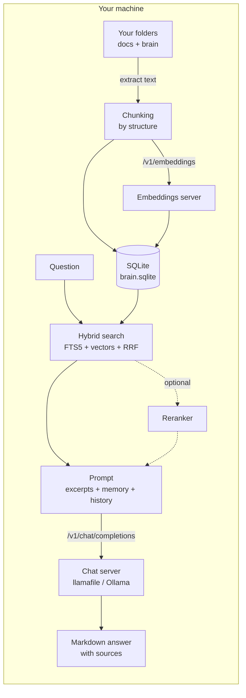

# Architecture

*(Português: [docs/pt/ARCHITECTURE.md](pt/ARCHITECTURE.md))*

## Overview



Nothing leaves the machine: the three servers are local processes (or a local Ollama).

## Folder structure

```
llamafile-brain/
├── src/
│   ├── main.js            # Electron main process: settings, IPC, servers, indexing, watchers
│   ├── preload.js         # secure bridge (contextBridge) → window.api
│   ├── shared/
│   │   └── i18n.js        # translations en/pt/es: t(key, params), setLang, catalog (main + renderer)
│   ├── core/              # pure logic, no Electron (testable in Node)
│   │   ├── rag.js         # builds the prompt, retrieves excerpts, calls the chat
│   │   ├── db.js          # BrainDB: SQLite (files, chunks, FTS5, vectors, memories)
│   │   ├── sqlite.js      # opens the database with node:sqlite
│   │   ├── indexer.js     # walks folders, extracts text, creates embeddings, idle watchdog
│   │   ├── chunker.js     # splits into chunks (Markdown headings, code declarations)
│   │   ├── client.js      # OpenAI-compatible client (embeddings, chat, health)
│   │   ├── llamafile.js   # starts/stops the llamafile process (GPU, ports, fail fast)
│   │   ├── memory.js      # memory commands (en/pt/es) and the prompt's memory block
│   │   ├── summarize.js   # "list the files" / "summarize the folder"
│   │   ├── rerank.js      # optional reranker (cross-encoder)
│   │   ├── evalset.js     # evaluation: hit rate and MRR
│   │   ├── ocr.js         # OCR through tesseract + pdftoppm
│   │   ├── deps.js        # detection/installation of optional dependencies
│   │   ├── bins.js        # locates external programs (PATH and default folders)
│   │   └── tokens.js      # token estimate
│   └── renderer/          # UI (plain HTML/CSS/JS, no framework)
│       ├── index.html     # text comes from data-i18n attributes
│       ├── renderer.js
│       ├── markdown.js    # safe Markdown renderer (DOM, no innerHTML)
│       └── styles.css
├── scripts/               # release.js, setup.js, fix-sandbox.js, make-icons.js, postinstall.js
├── test/                  # unit/integration tests + e2e/ (real Electron)
├── assets/                # logo and icon (SVG/PNG)
├── build/                 # icons used by electron-builder
├── docs/                  # guides (you are here); docs/pt = Portuguese
├── .github/               # CI, release, issue/PR templates
└── package.json           # metadata + electron-builder configuration
```

## Life of a question (`src/core/rag.js`)

1. **Memory commands** (`remember that…`, `forget…`, `what do you remember`, plus the Portuguese and Spanish forms) are handled by code and answered instantly.
2. **Folder intents** ("list the files", "summarize the folder") use `summarize.js` (map-reduce per file).
3. Otherwise: embed the question, run the **hybrid search**, apply the reranker (if on) and build the prompt with the excerpts, the profile/memory and the recent history.
4. The answer is streamed. Only the excerpts the model **cited** (`[n]`) show up as "sources".
5. If the embeddings server fails, search falls back to keywords with a warning.

## Languages (i18n)

`src/shared/i18n.js` is a small UMD module (no dependencies) shared by the main process and the renderer. The catalog maps `key → [English, Português, Español]`; `t(key, params)` returns the text for the current language (falling back to English), with `{name}` placeholders. The renderer translates the static HTML through `data-i18n` / `data-i18n-ph` attributes and a small rich-text parser (`` `code` ``, `**bold**`, `[link](https://…)`) that builds DOM nodes, never `innerHTML`. The selected language is the `language` setting; changing it re-renders the dynamic parts and tells the main process, so dialogs, indexing messages, errors and memory-command replies follow too.

The system prompts sent to the model are in English and tell it to **answer in the language of the user's latest message**, so the model's answer language does not depend on the UI language. Memory commands and folder intents are recognized in all three languages regardless of the UI language.

## Database

A single SQLite file (`brain.sqlite`, WAL mode) with:

| Table | Content |
|---|---|
| `meta` | vector dimension, version |
| `files` | path, hash, mtime, size, kind (`doc` or `brain`) |
| `chunks` | text, title, lines, vector (Float32 BLOB) |
| `chunks_fts` | FTS5 index (`remove_diacritics`) for keyword search |
| `memories`, `memories_fts` | the user's explicit memories |

Vector search is brute force (cosine) over an in-memory Float32 matrix — simple and fast up to a few hundred thousand chunks. Fusion uses **Reciprocal Rank Fusion** (K=60, configurable vector weight). Chunks from the *brain* folder get ×1.1.

## Main process × UI

The renderer runs with `contextIsolation` + `sandbox` and only sees `window.api` (`src/preload.js`). Each IPC channel validates its arguments in `main.js`. Events from main to the UI: `log`, `index-progress`, `index-done`, `index-error`, `chat-delta`, `chat-sources`, `chat-warn`, `memory-changed`, `servers-status`, `deps-progress`.

## Design decisions

- **No native modules:** `node:sqlite` (Electron 37+) avoids `node-gyp` and makes building installers for every system easier.
- **Explicit memory:** nothing is "learned" on its own; the user controls what is kept.
- **Fail early, with a clear message:** busy port, stopped server, a process that dies on start and indexing without progress (5 min) become messages in the user's language.
