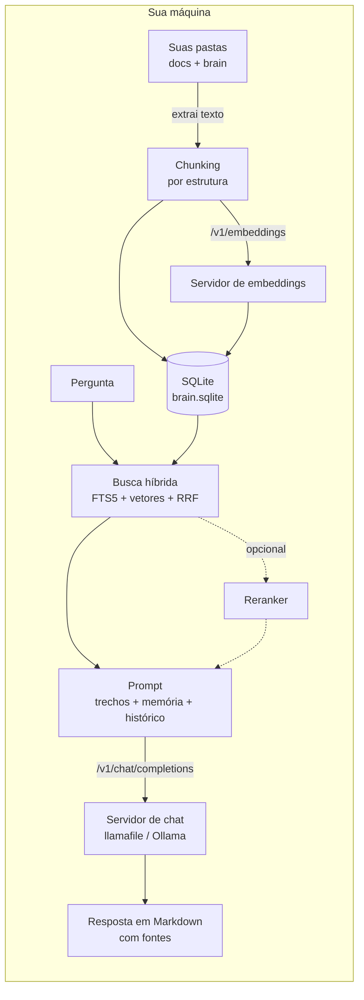

# Arquitetura

*(English: [docs/ARCHITECTURE.md](../ARCHITECTURE.md))*

## Visão geral



Nada sai da máquina: os três servidores são processos locais (ou um Ollama local).

## Estrutura de pastas

```
llamafile-brain/
├── src/
│   ├── main.js            # processo principal do Electron: configurações, IPC, servidores, indexação, vigias
│   ├── preload.js         # ponte segura (contextBridge) → window.api
│   ├── shared/i18n.js     # traduções en/pt/es: t(chave, params), setLang (main + renderer)
│   ├── core/              # lógica pura, sem Electron (testável em Node)
│   │   ├── rag.js         # monta o prompt, recupera trechos, chama o chat
│   │   ├── db.js          # BrainDB: SQLite (arquivos, trechos, FTS5, vetores, memórias)
│   │   ├── sqlite.js      # abre o banco com node:sqlite
│   │   ├── indexer.js     # percorre pastas, extrai texto, gera embeddings, vigia de inatividade
│   │   ├── chunker.js     # divide em trechos (títulos Markdown, declarações de código)
│   │   ├── client.js      # cliente OpenAI-compatível (embeddings, chat, health)
│   │   ├── llamafile.js   # inicia/para o processo llamafile (GPU, portas, falha rápida)
│   │   ├── memory.js      # comandos de memória e bloco de memória do prompt
│   │   ├── summarize.js   # "liste os arquivos" / "resuma a pasta"
│   │   ├── rerank.js      # reranker opcional (cross-encoder)
│   │   ├── evalset.js     # avaliação: taxa de acerto e MRR
│   │   ├── ocr.js         # OCR via tesseract + pdftoppm
│   │   ├── deps.js        # detecção/instalação de dependências opcionais
│   │   ├── bins.js        # localiza programas externos (PATH e pastas padrão)
│   │   └── tokens.js      # estimativa de tokens
│   └── renderer/          # interface (HTML/CSS/JS puro, sem framework)
│       ├── index.html
│       ├── renderer.js
│       ├── markdown.js    # renderizador de Markdown seguro (DOM, sem innerHTML)
│       └── styles.css
├── scripts/               # release.js, setup.js, fix-sandbox.js, make-icons.js, postinstall.js
├── test/                  # testes unitários/integração + e2e/ (Electron real)
├── assets/                # logo e ícone (SVG/PNG)
├── build/                 # ícones usados pelo electron-builder
├── docs/                  # guias (você está aqui)
├── .github/               # CI, release, templates de issue/PR
└── package.json           # metadados + configuração do electron-builder
```

## Fluxo de uma pergunta (`src/core/rag.js`)

1. **Comandos de memória** (`lembre que…`, `esqueça…`, `o que você lembra`) são tratados por código e respondem na hora.
2. **Intenções de pasta** ("liste os arquivos", "resuma a pasta") usam `summarize.js` (map-reduce por arquivo).
3. Caso contrário: gera o embedding da pergunta, faz a **busca híbrida**, aplica o reranker (se ligado) e monta o prompt com os trechos, o perfil/memória e o histórico recente.
4. A resposta é transmitida (streaming). Só aparecem como "fontes" os trechos que o modelo **citou** (`[n]`).
5. Se o servidor de embeddings falhar, a busca cai para palavras-chave com um aviso.

## Banco de dados

Um arquivo SQLite (`brain.sqlite`, modo WAL) com:

| Tabela | Conteúdo |
|---|---|
| `meta` | dimensão dos vetores, versão |
| `files` | caminho, hash, mtime, tamanho, tipo (`doc` ou `brain`) |
| `chunks` | texto, título, linhas, vetor (BLOB Float32) |
| `chunks_fts` | índice FTS5 (`remove_diacritics`) para busca por palavras |
| `memories`, `memories_fts` | memórias explícitas do usuário |

A busca vetorial é força bruta (cosseno) sobre uma matriz Float32 em memória — simples e rápida até algumas centenas de milhares de trechos. A fusão usa **Reciprocal Rank Fusion** (K=60, peso vetorial configurável). Trechos da pasta *brain* recebem ×1,1.

## Processo principal × interface

O renderer roda com `contextIsolation` + `sandbox` e só enxerga `window.api` (`src/preload.js`). Cada canal IPC valida os argumentos no `main.js`. Eventos do main para a interface: `log`, `index-progress`, `index-done`, `index-error`, `chat-delta`, `chat-sources`, `chat-warn`, `memory-changed`, `servers-status`, `deps-progress`.

## Decisões de projeto

- **Sem módulos nativos:** `node:sqlite` (Electron 37+) evita `node-gyp` e facilita gerar instaladores para todos os sistemas.
- **Memória explícita:** nada é "aprendido" sozinho; o usuário controla o que fica.
- **Falhar cedo, com mensagem clara:** porta ocupada, servidor parado, processo que morre ao iniciar e indexação sem progresso (5 min) viram mensagens no idioma escolhido (en/pt/es).
